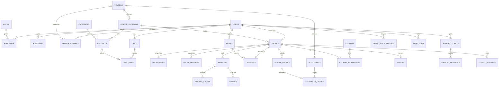
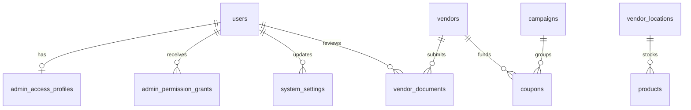

# MloExpress backend design

## Repository inspection (8 November 2026)

The starting repository is the Laravel 13 skeleton (framework constraint ^13.17), requiring PHP ^8.3, with Tinker; development dependencies include PHPUnit 12, Pint, Pail, Pao, Faker and Mockery. The Vite 8 / Tailwind 4 assets serve the default welcome page. There is no API route file, authentication API, business model, payment integration or order workflow. Existing migrations create users, password-reset tokens, sessions, cache and queue tables. Existing tests exercise the welcome page and a trivial unit assertion. Preserve that route and the baseline migrations. The adjacent Flutter application currently uses in-memory demo repositories, not this backend.

## Architecture and implementation plan

Use a modular monolith under `app/Modules`, with explicit services for transactional workflows, scoped query repositories for reads, thin HTTP controllers, policies and Form Requests. One MySQL database is the transaction boundary; Redis provides shared rate limiting, caching, locks and queues. Public records use ULIDs; the existing user numeric primary key remains internal with an added public ULID. Amounts are integer TZS, commission rates are basis points. No floating-point monetary calculations.

Modules: Identity (Sanctum, roles), Customers (addresses), Vendors (approval, locations and membership), Catalog (categories/products), Checkout (carts, pricing, reservations), Orders (snapshots/history/state machine), Payments (intents, signed events, refunds), Delivery (riders and assignment), Finance (append-only ledger and settlement batches), Notifications (transactional outbox/queued delivery), Promotions (coupons/redemptions), Engagement (reviews/support), Administration (approval, audit and role grants).

Implementation sequence: (1) additive schema and relationships; (2) scoped authorization and authentication; (3) catalogue/cart and atomic checkout; (4) payment intents, durable provider operations and webhooks; (5) order, refund and rider state machines; (6) ledger/settlements, supporting modules; (7) OpenAPI, workflow/security tests and deployment checks.

## ERD

## Migration plan

Keep the three baseline migrations. Add identity/public identifiers and role pivots, then vendors/locations/catalogue/customer addresses, then carts/coupons/orders and immutable item/address/price snapshots, then payments/events/refunds/deliveries, then ledger/settlements/idempotency/outbox/audit/engagement. Foreign keys prohibit deletion of referenced financial history. Soft-delete only editable addresses, vendors, locations and products. Unique provider event IDs, payment references, scoped idempotency keys, coupon/order redemptions, review/order keys and settlement ledger allocations prevent duplicate work. Compound indexes follow owner/status/created-at access patterns. Coordinates have bounding-box indexes; discovery applies a distance predicate after the bounding box. MySQL check constraints enforce nonnegative money and bounded coordinates/rates.

Run migrations on a disposable MySQL 8 database first, then backup and deploy additive changes before application rollout. Existing users receive public identifiers in bounded batches. Do not run destructive reset commands on live data. Ledger, payment-event and audit records are append-only; production database grants must deny UPDATE/DELETE on these tables for the runtime account. Reversals append compensating entries. Run deployment migrations with a separate privileged account. Rollbacks of financial migrations are development-only; production uses forward migrations and restores tested backups.

## Critical invariants

All user input is validated and resource ownership is checked in scoped repositories and policies. Only trusted operators approve vendors and grant administrator access. Approved vendors may create dedicated rider accounts belonging to their own business, with the rider role fixed by the server; they cannot grant additional roles or claim another business's riders. Vendor registration is pending until approval. A user may hold multiple roles and memberships. No request can set a role, approval state, computed price, commission, payment status or owner ID through mass assignment.

The backend specification in this request permits **cash pickup**. Such orders are explicitly unpaid until an authorized vendor records collection; delivery always requires verified mobile money before preparation. This differs from the adjacent Flutter app's current all-orders-prepaid rule. Mobile-money checkout reserves stock and snapshots a pending order; only an authenticated provider callback can confirm payment and release it for preparation. The pending record is a payment reservation, not an accepted kitchen order. The API exposes payment and order statuses separately. Checkout locks stock/cart/coupon rows and binds an idempotency key to an exact request digest. Retries return the original result; a changed body with the same key conflicts.

Webhook verification signs the raw request body with a timestamp and constant-time HMAC comparison. It rejects stale requests and duplicate event IDs, and validates merchant reference, currency, amount and legal state transitions. A configured provider adapter is required: no production fake-success adapter. Provider HTTP calls happen outside database locks using stable provider idempotency keys, and retries reconcile ambiguous outcomes rather than issuing new charges. Refund approval and settlement finalization cannot fabricate a successful external transfer.

Outbox records commit with financial/order changes; workers deliver notifications and private Reverb events after commit, retrying with stable event IDs. Clients treat events as invalidation hints and refetch authorized API resources. Financial rows are locked in a consistent order. Pagination is bounded, relationships eager-loaded and resource responses omit secrets and unnecessary PII.

## Deployment gates

PHP 8.4+, MySQL 8 and Redis are required. Configure HTTPS, trusted proxies, exact CORS/Sanctum origins, expiring tokens, provider secrets, mail/push delivery, queue supervision, scheduler, private Reverb origins/TLS, backups and monitoring. Provider sandbox certification, concurrency tests on real MySQL, reconciliation and restore drills are release gates. Local SQLite tests supplement but cannot prove MySQL locking behavior. Never commit `.env`, bearer tokens, provider credentials or webhook payloads containing sensitive payment data.

Primary framework references: [Sanctum](https://github.com/laravel/docs/blob/13.x/sanctum.md), [Reverb](https://github.com/laravel/docs/blob/13.x/reverb.md).

## Provider implementation decision

The user confirmed **Snippe (snippe.sh)** during implementation. The concrete adapter uses API version `2026-01-25`, with the provider's actual payment/payout endpoints and signed event envelopes. Account credentials remain private configuration. Refer to [operations](operations.md) for limits, reconciliation, refund-payout approvals and certification gates, and [verification results](validation.md) for completed checks.

## NextSMS delivery records

Additive migration: outbox_messages has zero or one sms_deliveries record (unique outbox_message_id foreign key). Records use the event ULID as public reference, encrypted recipient/body, a status/recovery index and unique provider message ID. The notification publisher stages this record transactionally before marking the event published. A separate notifications-queue job atomically claims queued records before the external request. Accepted, rejected and uncertain states prevent duplicate processing; the existing scheduler recovers undispatched queued records. Existing in-app/Reverb notifications continue independently.

## Administration expansion (2026-11-10)

Administrative collections share validated query controls: page 1–10,000, per_page 1–100, literal search, an allowlist of sort columns/directions, and inclusive East Africa dates translated to UTC ranges. Search/filter predicates run before pagination, with stable ID tie-breakers. User records expose public ULIDs; provider request payloads and private storage paths are explicitly excluded by AdminData. Nested order/rider/customer relationships are eager loaded.

The existing flat paginator contract is retained for old clients. New operations live in the Administration module and reuse the existing order/refund/payment/ledger services. AdminData is an explicit response serializer; it avoids exposing whole models while preserving the established JsonResponse/paginator shape.

Financial summaries use immutable posted ledger entries, including refund and refund-reversal entries. Captures and refunds are joined through the unique platform_commission entry per order/kind so gross amounts are not multiplied by the other ledger accounts. Reports support at most 366 days; exports stream at most 100,000 entries in chunks and bind a maximum ID before streaming. Read-only overview aggregates have a 20-second cache.

### Additive schema

The migration adds nullable product image paths, rider availability (true preserves existing eligibility), campaign associations and indexes supporting global date/status/ledger queries. It does not modify financial snapshots or rewrite existing transaction history. Newly created or restricted access profiles are enforced through AdminAccess middleware; absence of a profile preserves the existing unrestricted administrator behavior. Role removal, suspensions and permission changes are serialized using the administrator role row, and at least one unrestricted active administrator must remain.

Only delivery_base_fee, delivery_per_km, support_email, support_phone and support_hours can be changed through settings. Versions reject stale writes; secret/provider settings remain environment-managed. Delivery pricing changes apply only to future quotes/orders. Stock updates require expected_stock and compare under the product row lock before saving.

Product images are stored privately with generated names and served through controlled image routes. Verification documents are private, downloadable only by authorized administrators or members of the owning vendor. SVG/HTML/executable uploads are rejected. Verification reviews and exports are audited; uploaded bytes, passwords and provider secrets are never recorded in audit metadata.

## Optional customer accounts

Guest checkout reuses the checkout, payment and order services through narrowly scoped capability middleware. Internal anonymous ownership records have no login credentials or roles. Guest sessions scope carts/addresses, while separate per-order tokens scope order read/tracking/cancel/refund operations. Contacts are immutable order snapshots and are never used to claim registered users. The detailed ERD, additive migration sequence, token lifecycle and deployment constraints are documented in operations.md.
