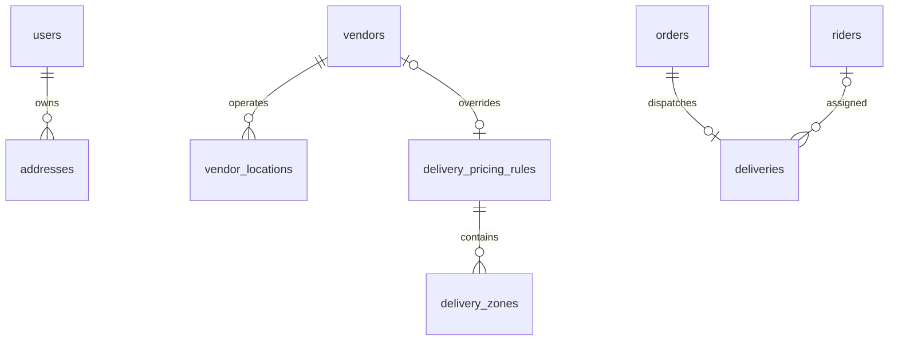

# Google Maps and delivery integration

## Inspection and implementation plan — 11 November 2026

The existing addresses table has user ownership, label/details, decimal coordinates and soft deletion. Vendor locations already hold decimal coordinates, a delivery radius and fulfilment flags with a compound geographic filter index. Orders already protect their address JSON and monetary snapshots. Deliveries already link orders and riders. No address or vendor-location replacement table is required.

1. Extend addresses with formatted address, place ID, landmark/instructions and an indexed default flag. Serialize address writes under the customer row and enforce at most one undeleted default with a generated unique key.
2. Extend vendor locations with place ID and explicit coordinate verification, and riders with last-known coordinates/time. Coordinate changes invalidate location verification. Existing orders remain readable and retain their original prices.
3. Add versioned global/vendor delivery pricing rules and related distance bands. Seed the global rule from existing configured delivery settings. Support fixed, base-plus-road-distance and distance-zone pricing, minimum fee and maximum road distance.
4. Add bounded, authenticated Places/Geocoding helpers and authorized delivery quote/tracking endpoints. Keep provider URLs/field masks fixed; use restricted server credentials and sanitized errors.
5. Prefilter discovery with the existing indexed bounding box and great-circle distance, then compare a bounded candidate set with one Routes matrix request. Expose unavailable road routes explicitly; never price delivery from straight-line distance.
6. Fetch road routes before checkout row locks. Revalidate coordinate fingerprints and current pricing inside the transaction, preserve same-key order replay, and store road distance/time plus pricing identity inside the existing immutable address snapshot.
7. Add Flutter Maps/GPS selection, saved/default-address management, vendor pickup selection and customer tracking previews, plus existing-template admin maps, verification and pricing/zone controls.
8. Test with provider fixtures only; document separate platform keys and remaining production setup.



Route caching is configurable by origin, destination, travel mode and response kind. Persistent Google response caching defaults off until the account's applicable agreement permits the requested retention. In-request prepared routes avoid HTTP calls inside database locks regardless of cache configuration. Place IDs can be retained; production operators must review Google's restrictions for other Google-derived content and immutable business snapshots: https://developers.google.com/maps/documentation/routes/policies . No map tile, Places directory or route geometry archive is built.

## Delivered APIs and data

Migration: `2026_11_11_065030_add_google_locations_and_delivery_pricing`. It extends addresses, vendor_locations and riders, and adds delivery_pricing_rules and delivery_zones. Local MySQL migration succeeded on 11 November 2026; production migration remains required. Existing immutable order address_snapshot stores the road distance/time, origin/destination, zone and pricing rule/version. Existing monetary columns remain authoritative.

All paths below start with `/api/v1`:

| Method | Path | Purpose |
| --- | --- | --- |
| POST | /location/autocomplete | Tanzania Places predictions, UUID session, at most five results |
| POST | /location/place | Selected place details with the same session |
| POST | /location/geocode | Forward address or reverse coordinate lookup |
| POST | /locations/{location}/delivery-quote | Quote to the authenticated customer's own address |
| GET | /orders/{order}/tracking | Authorized order map; optional include_route=1 |
| PATCH | /rider/deliveries/{delivery}/location | Approved assigned rider's position during active delivery |
| GET, POST | /admin/delivery-pricing | Paginated rules / create vendor override |
| PATCH | /admin/delivery-pricing/{rule} | Update using current version |
| POST | /admin/delivery-pricing/{rule}/zones | Add zone using parent rule version |
| PATCH | /admin/delivery-zones/{zone} | Update or disable zone using parent version |
| POST | /admin/locations/{location}/verify | Verify the exact coordinates currently displayed |
| GET | /admin/deliveries/{delivery}/tracking | Administrative delivery preview |

Existing address CRUD, cart quote/checkout, vendor onboarding/location updates and discovery are extended. Discovery supports `sort=recommended,nearest,fastest,lowest_fee` and `fulfilment=all,delivery,pickup`. Bounding-box/geographic filtering precedes a single road matrix for at most 25 candidates. Pagination and sorting cover that bounded candidate window; `search_limited` explicitly reports truncation. Pickup discovery skips Routes. Admin locations support `coordinate_status=valid,invalid` and `location_verification_status=pending,verified`, alongside existing filters.

## Keys and environments

Backend `.env` only:

```dotenv
GOOGLE_MAPS_SERVER_KEY=
GOOGLE_MAPS_ROUTE_CACHE_SECONDS=0
GOOGLE_MAPS_CANDIDATE_LIMIT=25
GOOGLE_MAPS_REQUESTS_PER_MINUTE=300
DELIVERY_MAXIMUM_DISTANCE_METERS=50000
```

Enable Routes API, Places API (New) and Geocoding API. Restrict the server key to those APIs and the VPS outbound IP, with separate production/development keys. Never expose this key in Flutter, browser variables or logs. Fixed provider hosts and field masks prevent an arbitrary Google proxy. Requests use a two-second connect timeout and five-second total timeout without automatic retries. Helpers allow 30 requests/user/minute and 300/minute across that helper limiter. Existing API, checkout and discovery throttles also apply; A shared application provider budget (GOOGLE_MAPS_REQUESTS_PER_MINUTE, capped at 300) also covers checkout and public discovery calls. Use Redis for a shared production limiter; Google project quotas remain the final cost boundary.

Flutter:

- Added and locked google_maps_flutter 2.19.0 and geolocator 14.1.2.
- Copy android/maps.properties.example to private android/maps.properties and set GOOGLE_MAPS_ANDROID_KEY, or supply that environment variable to the Android build. Restrict to Maps SDK for Android, actual application ID and debug/release signing SHA-1 certificates.
- Copy ios/Flutter/MapsKeys.xcconfig.example to private ios/Flutter/MapsKeys.xcconfig and set GOOGLE_MAPS_IOS_KEY. Restrict to Maps SDK for iOS and the actual bundle identifier.
- Set MAPS_ENABLED=true in the existing private Flutter .env. Build with `flutter build apk --dart-define-from-file=.env`. Maps default disabled until configured; search/manual address entry still works, while backend lookup and road quotes require the server key.
- Android coarse/fine permissions and SDK metadata, and iOS WhenInUse purpose/key injection, are configured. Permission is optional; no background location collector is started.
- Current Android application ID remains com.example.chips. Set the intended production app identifiers and matching restrictions before store release.
- Validate iOS compilation, selected native Google SDK deployment-target compatibility, permissions and signing on macOS/Xcode. This Windows environment cannot certify iOS. Existing iOS minimum support was not silently raised.

Admin Vercel:

- Set NEXT_PUBLIC_GOOGLE_MAPS_KEY to a separate Maps JavaScript API browser key. Restrict HTTP referrers to the production dashboard and approved preview/local origins. Redeploy after changes to this build-time variable.
- Keep the existing API_URL, ADMIN_APP_URL, ADMIN_SESSION_SECRET and explicit ALLOW_HTTP_API_PROXY configuration. Do not put the backend Google key in any NEXT_PUBLIC variable.
- Vendor maps display the current filtered page and coverage circles. Delivery previews load on demand; no route geometry is requested when the web key is absent. Pricing and verification retain existing confirmations, snackbar feedback and backend permission checks.

## Production rollout

1. Back up the database. Deploy the backend through the existing CI pipeline after server deployment prerequisites (deploy permissions and Supervisor services) are ready.
2. Configure the restricted server key, billing and quotas. Run `php8.5 artisan migrate --force` then `php8.5 artisan config:cache`; restart existing workers through the established deployment script.
3. Review the global pricing rule seeded from existing delivery settings. Configure vendor overrides and zone bands before enabling zone pricing. Existing orders retain their snapshots; per-km prices round up to whole TZS and minimum/maximum fees use database configuration.
4. Review and verify real vendor coordinates in the dashboard. Existing locations migrate to pending verification; pickup remains available but new delivery quotes require verified locations. Editing coordinates, address or place ID resets verification. Do not bulk-verify unknown locations.
5. Deploy the admin and mobile clients with their restricted platform keys. Test GPS denial, manual entry, address search/confirmation, road quotes, payment verification and pickup on actual devices. Preserve the existing Snippe webhooks, NextSMS configuration and explicit vendor cash confirmation; no payment success is simulated.

Road failure returns a retry/pickup message and never a geographic-distance charge. Checkout replay returns the original order without another route purchase. Routes are requested before database row locks; current coordinates, pricing and availability are checked within checkout. Rider positions disappear after 15 minutes or when an assignment is no longer active. Only the last point is retained, with no public history or continuous tracking client.

## Cost, privacy and retention

Use billing alerts, quotas, separate keys/projects and monitored failure counts. Autocomplete is debounced and uses UUID sessions. Discovery caps candidates, details use essential field masks, and maps/routes load lazily. Avoid logging provider headers/URLs, raw errors, personal coordinates and session tokens. Do not archive geometry or tiles. Set personal address and rider-point retention/access policies.

Persistent route caching defaults off. Review your Google agreement before enabling a cache (application cap: 300 seconds). Google-derived addresses, coordinates and immutable road metrics also require an applicable retention basis; the business snapshot implementation is not a claim that provider content can be retained indefinitely. Review [Routes policies](https://developers.google.com/maps/documentation/routes/policies) and [Maps service terms](https://cloud.google.com/maps-platform/terms/maps-service-terms). SDKs supply map attribution; address suggestions and non-map road estimates identify Google Maps. Publish your application's privacy policy and terms before production Maps use.

## Verification and outstanding setup

Tests use provider HTTP fixtures and do not consume paid Google calls. Coverage includes road/zone/minimum/max pricing, immutable snapshots, replay, provider failure/timeouts, address defaults/ownership, coordinate verification, bounded discovery and active rider privacy. Flutter covers permission branches, invalid coordinates, manual confirmation and polyline decoding. Admin covers fixed-operation validation, version guards, bounded filters, sanitized DTOs and map fallback.

Restricted production keys, Google billing/quotas, actual-device rendering, macOS/iOS validation and production deployment remain operator setup tasks. No live provider request or real-device rendering is claimed by fixture tests.

## Changed-file inventory

Backend changes in this integration:

- `.env.example`, `config/maps.php`, `routes/api.php`, `app/Providers/AppServiceProvider.php`.
- `database/migrations/2026_11_11_065030_add_google_locations_and_delivery_pricing.php`.
- Models: Address, VendorLocation, Rider, Order, DeliveryPricingRule, DeliveryZone.
- Factories: VendorLocationFactory, DeliveryPricingRuleFactory, DeliveryZoneFactory.
- `app/Modules/Delivery/GoogleMapsService.php`, `DeliveryPricingService.php`, `LocationController.php`.
- Checkout: CheckoutService, PricingService, CheckoutRequest.
- Customers: existing AddressController; vendors: VendorController; catalogue: DiscoveryRepository, CatalogController.
- Administration: AdminLocationController, AdminCatalogController, AdminData, AdminSettingsController.
- `resources/openapi/operations.json`, `resources/openapi/schemas.json`, generated `docs/openapi.json`.
- Tests: MapsAndLocationsTest, TestCase, existing MarketplaceTest and AdministrationTest fixture setup.

Flutter changes:

- `pubspec.yaml`, `pubspec.lock`, `.env.example`, `.gitignore`.
- `android/app/build.gradle.kts`, `android/app/src/main/AndroidManifest.xml`, `android/maps.properties.example`.
- `ios/Runner/AppDelegate.swift`, `ios/Runner/Info.plist`, `ios/Flutter/Debug.xcconfig`, `ios/Flutter/Release.xcconfig`, `ios/Flutter/MapsKeys.xcconfig.example`.
- `lib/app/config/environment.dart`, `lib/app/router/app_router.dart`, `lib/app/app_store.dart`.
- `lib/shared/models/models.dart`, `lib/shared/services/laravel_backend.dart`, new `lib/shared/services/location_service.dart`, `lib/shared/widgets/components.dart`.
- New location_picker, saved_addresses_screen and delivery_map_preview under `lib/features/location/`.
- Existing discovery, checkout, order, vendor onboarding and vendor workspace screens.
- `test/location_test.dart`, `test/support/api_fixture.dart`.

Admin changes:

- `.env.example`, `package.json`, `package-lock.json`, `playwright.config.ts`.
- New `src/features/location/MapPanel.tsx`, `DeliveryMapButton.tsx`, `DeliveryPricing.tsx`.
- Existing shared Collection and admin-actions, Vendors, Riders, Administration.
- `src/lib/admin-resources.ts`, `src/server/operations.ts`, `src/app/api/admin/[...path]/route.ts`.
- `tests/unit/maps.test.ts`, `tests/e2e/api-fixture.mjs`, `tests/e2e/admin.spec.ts`; formatting-only cleanup in `tests/unit/gateway.test.ts`.

No backend dependency was added, and no private Google key was created or committed. Existing unrelated repository tooling files and previously completed launcher/calendar work remain intact.

Validation on 11 November 2026: backend full suite 109 passed (1,843 assertions), focused Maps suite 19 passed (104 assertions), including the shared provider-budget guard, Larastan and Pint clean, migration applied to local MySQL. Flutter suite 38 passed with one optional live-server test skipped; analysis clean and Android debug APK built. Admin 57 unit tests passed, production build passed, all 15 existing browser workflows passed, and the new map/pricing workflow passed after fixing its fixture assertion. No paid provider requests were made. A previously documented development-only Floating UI/Suspense hydration warning remains observable when opening a dialog before sibling streamed content hydrates; it did not fail browser workflows or production compilation.

The mobile integration also adds ios/Podfile from the installed Flutter SDK template, with BYPASS_PERMISSION_LOCATION_ALWAYS=1 for geolocator_apple, and optional Pods xcconfig includes. The selected Google Maps iOS plugin currently ships a podspec rather than an SPM manifest. On macOS run flutter pub get, install pods, and build Runner.xcworkspace. Resolve native SDK compatibility against the existing iOS 15 deployment target before a release. For SPM geolocator builds, set BYPASS_PERMISSION_LOCATION_ALWAYS=1 in the build environment before resolution. See the mobile LOCATION_SETUP.md.

Workspace publishing: backend and admin use their existing GitLab repositories. The Flutter folder has no Git repository configured; it needs a mobile repository before publishing. Source publication does not confirm production deployment or live Maps setup. Existing unrelated repository tooling files are excluded from the integration commit.
