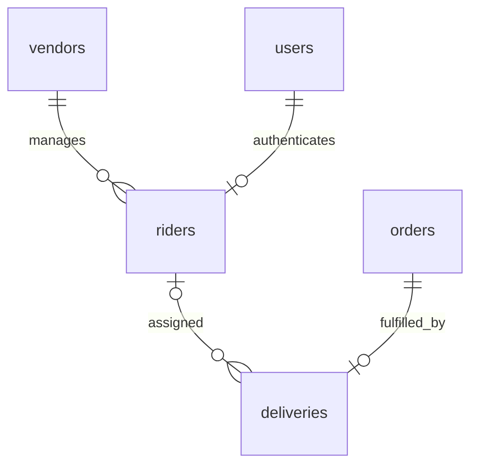
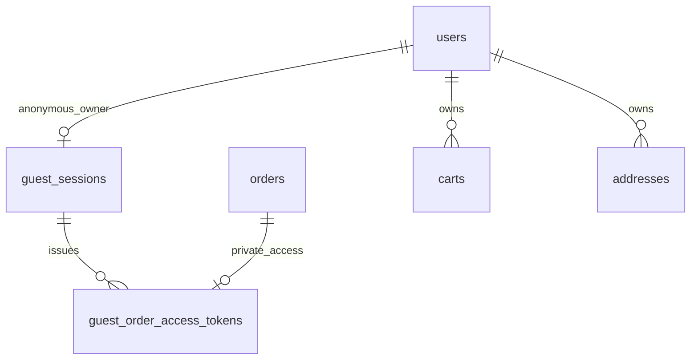

# Operations and release gates

## GitLab CI/CD

Primary repository: `git@gitlab.com:andreamsilu/chips-api.git`. `.gitlab-ci.yml` runs PHP 8.4/8.5 checks with isolated MySQL 8 and Redis services, the feature/unit suite, real MySQL concurrency tests, Composer validation/audit, Larastan, Pint and OpenAPI consistency. Production dependencies are packaged from `composer.lock`; deployment never runs `composer update`.

Successful protected `main` pipelines automatically deploy to `/var/www/chips-api` on `185.213.27.206`. Protect `main`, restrict who can push/merge and use a Docker-capable GitLab runner. Enable GitLab's prevention of outdated deployment jobs. The job also checks the current `main` revision and uses a GitLab resource group plus a server file lock to serialize deployments.

Configure these GitLab **Settings → CI/CD → Variables**, protected and scoped to the `production` environment:

| Variable | Type | Value |
| --- | --- | --- |
| `SSH_PRIVATE_KEY` | File | Dedicated CI-to-server Ed25519 private key, with a trailing newline. Use a separate key from the developer's GitLab push key. |
| `SSH_KNOWN_HOSTS` | File | Verified SSH host key entry for `185.213.27.206`, obtained through a trusted server console. |
| `DEPLOY_USER` | Variable | `deploy`, unless a different provisioned account is used. |

The public host, SSH port `22`, application directory and public URL have pipeline defaults. SSH is noninteractive with strict host checking. Keep `.env`, database/Snippe/NextSMS credentials and `APP_KEY` on the server. They are never CI artifacts. Follow [GitLab's SSH variable guidance](https://docs.gitlab.com/ci/jobs/ssh_keys/); multiline key file variables cannot be masked, so restrict protected-ref/environment access and never print them. Do not run unverified `ssh-keyscan` inside the pipeline.

One-time server setup, as root, after the CI files are present in the checkout:

```sh
apt install -y rsync curl supervisor sudo php8.5-cli php8.5-fpm php8.5-mysql php8.5-redis php8.5-xml php8.5-curl php8.5-mbstring php8.5-bcmath
id deploy >/dev/null 2>&1 || adduser --disabled-password --gecos '' deploy
usermod -aG www-data deploy
chown -R deploy:www-data /var/www/chips-api
chmod 640 /var/www/chips-api/.env
chown -R www-data:www-data /var/www/chips-api/storage /var/www/chips-api/bootstrap/cache
find /var/www/chips-api/storage /var/www/chips-api/bootstrap/cache -type d -exec chmod 2770 {} +
find /var/www/chips-api/storage /var/www/chips-api/bootstrap/cache -type f -exec chmod 660 {} +
install -d -m 700 -o deploy -g deploy /home/deploy/.ssh
```

Generate a separate deployment key on a trusted machine. Put its public key in `/home/deploy/.ssh/authorized_keys`, owned by `deploy:deploy`, mode `600`; put only its private key into the protected `SSH_PRIVATE_KEY` file variable. Keep the private key outside the application directory. On the trusted server console, this prints the public host-key entry for `SSH_KNOWN_HOSTS` on port 22:

```sh
awk '{print "185.213.27.206 " $1 " " $2}' /etc/ssh/ssh_host_ed25519_key.pub
```

Configure the server `.env` for production, including valid Redis/MySQL and Reverb credentials. Install managed workers:

```sh
cp /var/www/chips-api/resources/ci/supervisor.conf /etc/supervisor/conf.d/chips-api.conf
systemctl enable --now supervisor
supervisorctl reread
supervisorctl update
supervisorctl status
```

Ensure all four `chips-api-*` programs are running before enabling deployments. This scheduler replaces a separate cron/schedule worker: keep one scheduling mechanism. Configure Reverb privately before starting its worker. Nginx continues using `/var/www/chips-api/public` and the PHP 8.5 FPM socket.

Use `visudo -f /etc/sudoers.d/chips-api-deploy` to grant these exact service operations (one line):

```sudoers
deploy ALL=(root) NOPASSWD: /usr/bin/systemctl reload php8.5-fpm, /usr/bin/supervisorctl status chips-api-payments chips-api-notifications chips-api-scheduler chips-api-reverb, /usr/bin/supervisorctl stop chips-api-payments chips-api-notifications chips-api-scheduler chips-api-reverb, /usr/bin/supervisorctl start chips-api-payments chips-api-notifications chips-api-scheduler chips-api-reverb
```

Deployment verifies the archive checksum/revision, enters maintenance, stops workers gracefully, backs up code and replaces code/vendor while preserving `.env*`, `storage`, `.git`, deployment backups and the public storage link. It then clears generated bootstrap files, discovers production packages, migrates forward, backfills missing public user IDs, links public storage, warms caches, reloads PHP-FPM, resumes app/workers and checks `/up` plus the database/cache-backed categories endpoint. It creates no accounts or catalogue seed data.

Incoming artifacts and previous code remain under `/var/www/chips-api/.deploy`; monitor disk usage and prune only releases no longer needed. A failure after maintenance begins leaves maintenance enabled and reports the backup location. **Database migrations are never automatically rolled back.** Restore compatible code from the reported backup or deploy a forward fix, check schema compatibility, reload PHP-FPM, run `php8.5 artisan up` and restart Supervisor programs. A code backup is not a database backup; retain the existing database backup policy.

Verify the first live pipeline and SSH deployment in GitLab after variables/server prerequisites are configured. Local syntax/static checks do not replace running the pipeline on GitLab's runner.

## Initial installation

Use PHP 8.4+ with PDO MySQL, Redis, OpenSSL, mbstring, XML, cURL and bcmath; MySQL 8.0.16+; Redis 7; and Composer 2. The Windows development runtime was installed at `%USERPROFILE%\.config\herd-lite\bin`. Reopen an existing terminal if PHP/Composer do not appear on its PATH.

Copy `.env.example` to a private `.env` and provision secrets through your deployment platform. Use a separate migration account with DDL/TRIGGER privileges and a runtime account with the minimum table privileges. Never publish `.env` or use the CI credentials outside disposable tests. Keep `APP_DEBUG=false`. Preserve `APP_KEY` across deployments because payment contact details and immutable provider payloads are encrypted with it; include key recovery in backup procedures.

```sh
composer install --no-dev --prefer-dist --no-interaction --optimize-autoloader
php artisan key:generate # First installation only; never rotate blindly on an existing database.
php artisan migrate --force
php artisan marketplace:backfill-user-ids
php artisan db:seed --force
php artisan optimize
php artisan queue:restart
```

The seeder installs categories only. It intentionally creates no default users or known passwords. Register a real account, then use trusted server access once:

```sh
php artisan marketplace:bootstrap-admin operator@example.com --confirm
```

Subsequent grants use the administrator API. Do not grant administrative roles through registration or client-controlled session claims. Existing accounts need customer roles assigned by an administrator before checkout.

## Processes

Supervise PHP-FPM/the application server, a scheduler, separate payment and notification workers, and Reverb. Example worker commands:

```sh
php artisan queue:work redis --queue=payments --sleep=1 --timeout=45 --tries=6 --max-time=3600
php artisan queue:work redis --queue=notifications --sleep=1 --timeout=45 --tries=5 --max-time=3600
php artisan schedule:work
php artisan reverb:start --host=127.0.0.1 --port=8080
```

In a traditional deployment run `php artisan schedule:run` every minute instead of `schedule:work`. Queue `retry_after` is 90 seconds by default in the template, longer than the worker timeout. API processes, schedulers and workers must share Redis and the database. Use Redis persistence and a dedicated queue database/namespace; do not evict queue or uniqueness-lock keys with catalogue caches.

Checkout dispatches payment work after commit. A database outbox dispatches notifications after commit. `marketplace:tick` rescans durable pending rows every minute to recover the process-crash or Redis-failure gap; it also expires unpaid 15-minute stock reservations and reconciles acknowledged payment/refund attempts. This command processes bounded batches. Monitor backlog age and adjust scheduler frequency/worker count before load exceeds that capacity.

Expose the web server's `public/` directory only. Enforce HTTPS and body-size limits (16 KiB for payment callbacks) at the proxy. Configure trusted proxy addresses in Laravel for your actual ingress before relying on forwarded scheme/client IP. Set exact CORS origins and Reverb allowed hostnames; never use credentialed wildcard origins. Terminate Reverb TLS at the proxy, retain private-channel authentication and block direct access to its private listener.

## Snippe configuration and certification

The adapter implements Snippe API version `2026-01-25`, using documented REST endpoints and the signed event envelope. Set the same API version in the merchant dashboard. Set `SNIPPE_API_KEY`, `SNIPPE_WEBHOOK_SECRET` and the externally reachable HTTPS `SNIPPE_WEBHOOK_URL` ending in `/api/v1/webhooks/payments`. `SNIPPE_BASE_URL` defaults to `https://api.snippe.sh`. Collection keys need `collection:read` and `collection:create`. Never place a provider key in Flutter, browser JavaScript, a Next.js public environment variable, a URL or a log.

Subscribe to `payment.completed`, `payment.failed`, `payment.expired`, `payment.voided`; refund payouts additionally use `payout.completed`, `payout.failed`, `payout.reversed`. The signature is hex HMAC-SHA256 over `timestamp.raw-body`, from `X-Webhook-Timestamp` and `X-Webhook-Signature`. Unsigned events are rejected even if the provider treats signing as optional. Only the pinned event version is accepted. Store event identifiers and payload hashes, not full payment webhook payloads.

Snippe mobile payments require at least TZS 500. A create response is an acknowledgement, never proof of payment. An authenticated status GET is a second authoritative verification path. The adapter validates amounts, currency, provider reference and order metadata; refunds also validate that the recipient matches the original payer. The provider request body is encrypted and fixed at checkout so retrying the same key cannot silently change the customer or amount. ULID operation keys remain below Snippe's 30-character maximum. Automatic resubmission stops after 23 hours, before the provider's documented 24-hour idempotency expiry.

Refunds are full refunds only. Snippe's published API documents disbursements rather than a native payment-refund endpoint; the adapter returns funds to the original mobile-money phone using an explicitly approved payout. Enable `SNIPPE_PAYOUTS_ENABLED=true` only after account permissions, supported refund networks, balance/fee handling and sandbox tests are confirmed. Such keys also need `disbursement:read` and `disbursement:create`. Refunds below the configured implementation threshold of TZS 5,000, or while disbursements are disabled, enter `manual_required`. After an operator actually returns funds externally, an authorized administrator may attest the unique receipt with `receipt_verified=true`. This administrative attestation is audited; it never initiates a transfer.

Failed/reversed payouts require operator recovery. Do not blindly send another payout with a new key. A reversal retains the original payout reference and appends compensating ledger entries; manual recovery retains its separate receipt. After a network timeout where the provider may have accepted a request, retain the original key and body. If its reference was lost and the safe retry window elapsed, locate the transaction in the merchant dashboard and reconcile it before any new operation. Alert on stale `pending`, `approved`, `manual_required`, `failed` or `reversed` records.

Provider processing fees are merchant expenses and are not deducted from the vendor's snapshotted commission calculation. Reconcile Snippe settlement statements and fees in the accounting close before paying vendors. This implementation does not automatically withdraw vendor settlements: `paid` records an already verified external transfer. Settlement preparation excludes unfulfilled/unpaid/refund-pending orders and carries cash commission debt forward. If a refund changes a prepared batch, payment is blocked; void the unpaid batch and prepare it again. Original allocations remain in history.

Official references: [payments](https://docs.snippe.sh/docs/2026-01-25/payments), [mobile money](https://docs.snippe.sh/docs/2026-01-25/payments/mobile-money), [webhooks](https://docs.snippe.sh/docs/2026-01-25/webhooks), [disbursements](https://docs.snippe.sh/docs/2026-01-25/disbursements/mobile-money).

## Observability, backups and recovery

Alert on failed jobs, oldest unpublished outbox message, ageing payment reservations, uncertain provider operations, unpaid settlements, callback rejection spikes, Redis failures and database deadlocks. Correlate with public order/payment IDs; redact authorization, API keys, phone numbers and provider bodies in upstream logging/APM. Database deadlocks retry transactional workflows three times. Do not retry permanent validation failures as new financial operations.

Inspect failed jobs with `php artisan queue:failed`, fix the cause, and retry selected IDs. The durable scanner may already have recovered their logical operation, so provider idempotency and database constraints remain mandatory. Do not clear all locks or restart queues to conceal a provider outage. An administrator should reconcile provider statements against payments, refunds, the balanced ledger and external settlement receipts each day.

Back up MySQL, application encryption keys and necessary object storage; encrypt backups, restrict access and test point-in-time restoration. Keep financial/order/payment event/audit records according to a published retention policy. Avoid cascading deletes on financial records. MySQL and SQLite migrations install append-only/snapshot triggers; give the runtime account no DDL/trigger-altering permissions. Production schema rollback is a forward-fix operation, not `migrate:reset` or `migrate:fresh`.

## Verification and outstanding release gates

```sh
composer install
composer test
composer analyse
composer format
composer validate --no-check-publish
composer audit
composer openapi
```

Local unit/feature tests use isolated SQLite, array cache, null broadcasting and database-backed test queues without running workers. Discovery tests supply SQLite's absent trigonometric functions using their actual PHP math implementations; production MySQL uses native functions. Run the same suite on MySQL 8 before release. The provided CI workflow runs PHP 8.4/8.5 with MySQL 8 and Redis and invokes additional two-process row-lock tests. To run those manually, supply a **disposable MySQL database ending in `_test`** and execute `php vendor/bin/phpunit tests/Integration/MySqlConcurrencyTest.php`. These tests explicitly reset that test database and refuse other names. They cannot establish correctness on SQLite.

During the original implementation local MySQL credentials were rejected and Docker's daemon was unavailable. Local MySQL access was repaired on 10 November and the 34 administration cases passed on an isolated MySQL 8 database. The separate process-concurrency tests, real Redis queue recovery and Reverb socket delivery remain unverified locally. CI is supplied but has not been run remotely. Snippe calls are tested with exact HTTP fixtures; no live charge, refund, transfer or sandbox certification has been performed. Configure merchant credentials privately and run account-specific certification before enabling payments. Load tests and `EXPLAIN` plans with production-like vendor/order data, backup/restore drills, secret rotation, provider fee reconciliation and operator approval procedures remain deployment gates.

The adjacent Flutter client is wired to the bearer API and uses email/password authentication, secure token storage and foreground order polling. Its optional demo OTP flow is isolated behind DEMO_MODE=true. The adjacent chips-admin Next.js dashboard uses a server-side Sanctum gateway; its encrypted HttpOnly session never exposes bearer tokens to browser code. Configure exact CORS origins for Flutter Web and HTTPS API_URL for release builds. Email/push delivery is not configured; NextSMS order alerts are available with private configuration; queued in-app notifications and private Reverb invalidations are implemented. Account recovery/email verification, partial refunds, live GPS/maps and automated vendor bank payouts are future integrations, not simulated features.

## NextSMS customer order alerts

Uses the official [NextSMS v2 API](https://www.nextsms.co.tz/api-docs), POST /api/sms/v2/text/single with bearer-token authentication. Configure NEXTSMS_API_TOKEN and your approved NEXTSMS_SENDER_ID privately, then set NEXTSMS_ENABLED=true. Defaults are disabled and credentials are blank in .env.example. Rebuild configuration cache and restart notification workers after changing secrets. No new dependency or client-side secret is needed. Email/password authentication remains unchanged; this integration does not introduce OTP login.

Deployment: run php artisan migrate before enabling SMS or deploying enabled workers. The additive sms_deliveries migration references outbox_messages one-to-one, indexes status/created_at for recovery, and stores recipient/message encrypted using APP_KEY. No existing rows are rewritten. Preserve APP_KEY with backups. Production rollback should be a forward fix; dropping the table loses delivery/reconciliation records.

Run the existing notifications queue and scheduler. Alerts use event snapshots; obsolete unpublished snapshots are skipped rather than prompting customers to authorize a cancelled/already-paid order. Missing/invalid Tanzania customer numbers are skipped. A successful HTTP response must contain an accepted recipient and provider message ID; accepted means provider acceptance, not handset delivery. A 429 is retried by marketplace:tick after at least one minute, with at most five submissions. Other explicit client rejections stop sending.

No automatic resend occurs for unknown outcomes (timeouts, server failures, malformed responses) or submitting records left by a crashed worker. The reference equals the outbox event ID for merchant-dashboard investigation; it is not assumed to provide provider idempotency. Operators must confirm acceptance/rejection in NextSMS reports before considering a resend. Provider response bodies, tokens and plaintext recipients/messages are not written to application logs or failed-job payloads. Delivery callbacks/report polling are not exposed by this change; consult the merchant dashboard for final delivery. Monitor queued, unknown, rejected and stale submitting records. Disabled operation does not backfill already published historical events.

Legacy Basic-auth accounts can instead set NEXT_SMS_AUTHORIZATION privately, NEXT_SMS_API_URL=https://messaging-service.co.tz/api/sms/v1/text/single and NEXT_SMS_SENDER_ID to their approved sender. The latter sender overrides NEXTSMS_SENDER_ID when nonempty. Keep NEXTSMS_ENABLED=true only when ready for queued order alerts. V1 requires Basic authentication; v2 requires NEXTSMS_API_TOKEN and an empty NEXT_SMS_AUTHORIZATION. Only these two exact HTTPS single-message endpoints are allowed, and redirects remain disabled. V1 sends the documented from/to/text fields; the outbox retains the local event identifier. Invalid combinations fail before a network request. Do not place actual authorization values in deployment artifacts or source control.

NextSMS transport tests use HTTP fixtures only. No live SMS has been sent; credentials, approved sender, migration and account-specific delivery verification are still required.

## Deploying the administration expansion

Deploy backend and dashboard from matching versions. Put the API into maintenance mode through the existing deployment process, install from composer.lock, then run migrations before re-enabling traffic. The new admin authentication profile reads its access tables, so serving the new code before applying its migration is unsupported.

```sh
php8.5 artisan migrate --force --no-interaction
php8.5 artisan marketplace:backfill-user-ids --no-interaction
php8.5 artisan config:cache
php8.5 artisan queue:restart
```

Migration 2026_11_09_203923_add_administration_capabilities is additive. It was applied to the local WSL MySQL instance; this does not deploy it to production. Run the normal deployment checks and back up the production database before deploying. Existing administrators remain unrestricted until explicitly assigned an access profile. The API prevents removal/suspension/restriction of the last active unrestricted administrator.

Administrative endpoints require an active admin role and a module read/manage permission. GET /api/v1/admin/roles returns the catalogue; PUT /api/v1/admin/users/{public_id}/permissions controls the assigned scopes. Changing permissions, replacing roles, suspending accounts or resetting passwords revokes existing tokens. There are no seeded administrator passwords.

Search, filters and sorting are server-side. per_page is bounded to 100 and page to 10,000. Large exports must be narrowed to 366 days and 100,000 ledger entries. Net period revenue may be negative when a refund posts later than its original capture; do not substitute order totals for ledger balances. Reconciliation is a queued provider verification, not an operator payment-success override.

Uploads require writable storage/app/private. Public product images are served through the product-image endpoint; private verification documents must not be exposed by a web-server alias or public symlink. Images are JPEG/PNG/WebP (5 MB, 4096×4096); documents are PDF/JPEG/PNG (10 MB). Keep Nginx/PHP request limits compatible with these bounds and the existing authentication/rate limits enabled. Production provider secrets remain in deployment configuration and are not available in dashboard settings.

## Vendor-managed deliveries and riders

The rider schema currently has one unique user account per rider and no business ownership. Add a nullable vendor_id foreign key and a (vendor_id, status, available) index. Existing rider records remain unowned until an administrator associates them with a vendor; do not infer ownership from historical jobs. The vendor rider and delivery APIs scope every read and write to an approved business that the caller manages. Vendors create dedicated rider accounts with only the rider role, manage their availability/status, assign their own riders, and record pickup/completion. Platform administrators retain audited oversight. Rider self-service remains restricted to assigned deliveries.



New checkout snapshots set delivery.fee_beneficiary=vendor. On verified payment the vendor payable includes the food net of commission plus delivery fee; platform commission remains calculated on food only. Legacy orders without this marker retain their original platform delivery-fee allocation, including later refunds. Immutable snapshots and prior ledger entries are not rewritten. Rider wages/transfers remain the vendor's responsibility and are not automatically paid by this change.

Vendor delivery endpoints (all under /api/v1, Sanctum authentication required):

- GET/POST /vendor/businesses/{vendor}/riders — paginated own roster / create a dedicated rider account.
- PATCH /vendor/businesses/{vendor}/riders/{rider} — update own rider vehicle, availability or approved/suspended status.
- GET /vendor/businesses/{vendor}/deliveries — paginated own delivery orders, with status/rider/order filters.
- POST /vendor/businesses/{vendor}/deliveries/{delivery}/assignment — assign/reassign an owned, available rider to a verified-paid, ready order.
- PATCH /vendor/businesses/{vendor}/deliveries/{delivery} — record picked_up or delivered, with payment and transition guards.

Flutter vendor workspace: Orders → Manage deliveries & riders. Vendors can create rider logins, edit vehicles, change availability/status, assign riders, confirm pickup/completion and open the existing delivery-map preview. New rider accounts receive only the rider role; credentials are not returned or logged. The vendor supplies and privately shares an initial password. Existing registered accounts are not silently claimed by another business. Administrators can associate legacy rider profiles with a vendor through the rider edit form. Ownership transfer is blocked during active assignments and clears the last known position on a permitted transfer.

Run the additive add_vendor_ownership_to_riders migration before deploying these APIs. Do not auto-backfill vendor_id from historical deliveries. One rider profile belongs to at most one vendor in this implementation. A rider cannot receive a second active assignment; suspension requires reassignment or completion of active work. Existing admin assignment endpoints remain available for audited oversight and reject riders owned by a different vendor.

The delivery fee is credited to the vendor settlement balance only after verified customer payment. Settlement release still follows completed-delivery eligibility and the existing verified external-transfer workflow. This change does not initiate vendor or rider payouts automatically. Delivery pricing and mobile-money verification stay server-controlled. Existing orders without fee_beneficiary=vendor retain their original allocation.

Validation for vendor delivery ownership: the backend suite passes 121 tests (1,965 assertions), including tenant isolation, rider-account role restrictions, verified-payment assignment, busy-rider protection, active-transfer prevention, historical fee allocation, settlement amount and refund reversal. Larastan and Pint pass, and the additive migration has run successfully on local MySQL. Flutter analysis is clean; its broader suite passes 41 tests with the optional live-server check skipped, and all four focused vendor workflow tests pass, including rider creation and vehicle editing. Admin unit tests (57), type checks, lint and production build pass. Provider calls in automated tests remain faked. These changes require production deployment and the new migration before using the updated mobile controls against the VPS.

The updated Android debug APK was rebuilt successfully at the Flutter workspace's build/app/outputs/flutter-apk/app-debug.apk. Install it only with a compatible backend deployment when testing the new vendor controls; the production migration and publication are separate from local verification. No live payment, SMS, vendor transfer or rider payout was initiated during these checks.

## Guest checkout architecture and migration plan

Keep catalogue browsing public. Guest carts and addresses use a private, expiring anonymous session token, never a phone-number lookup. Existing cart/order/payment services continue to use an internal User ownership key; mark those records is_guest, permit null email/password for these non-login identities, and grant them no roles or Sanctum tokens. Registered-account registration and staff permissions remain unchanged. Guest contact information belongs to the immutable order snapshot, not a shared account identified by phone/email.

Add guest_sessions (ULID, unique user FK, unique SHA-256 token hash, expiry) and guest_order_access_tokens (ULID, unique order FK, session FK, unique token hash, encrypted recoverable token for idempotent replay, expiry). Store only hashes for request authentication. Return the order capability only after authorized guest checkout, over the private no-store response. Separate middleware accepts X-Guest-Token only on guest cart/address/checkout routes and X-Order-Token only on that single order's read/tracking/cancel/refund routes. Neither token authenticates registered-account, vendor, rider or administrative operations.



Mobile clients create guest sessions lazily, retain their opaque tokens in secure storage, and keep account login optional. Guest orders are accessible through privately retained per-order tokens on that device; registering/logging in with the same phone/email never claims another order. A phone-only order recovery/OTP flow is outside this change. Snippe's existing direct mobile-money collection endpoint requires an actual email, so guest checkout asks for payment email without registering an account or accepting a password. Preserve pricing, paid-before-preparation gates, financial snapshots, signed webhooks, refund checks and vendor-owned delivery fees.

Guest configuration uses the existing APP_KEY to encrypt replayable order tokens; preserve it across deployments and backups. Optional GUEST_SESSION_TTL_MINUTES defaults to 10080 (7 days) and GUEST_ORDER_TTL_MINUTES to 43200 (30 days). CORS allows X-Guest-Token and X-Order-Token only for the existing configured origins. Do not log these headers, expose tokens in URLs, or publish anonymous order histories. Reinstalling/clearing app storage loses private order access; no phone-only recovery or automatic account claiming is implemented.

POST /guest/sessions creates only an anonymous ownership record, without phone, email, password, roles or Sanctum access. Use its token for /guest/cart, /guest/cart/items, /guest/cart/quote, /guest/addresses, /guest/location/* and /guest/checkout. Idempotency-Key remains required at checkout. The checkout response includes guest_order_token and guest_order_expires_at alongside data; replay returns the same encrypted-at-rest capability. Use that token for /guest/orders/{order}, /tracking, /cancel and /refund. There is deliberately no public guest order-list/search endpoint. Existing administrator reconciliation remains administrator-only.

POST /cart/guest-merge requires both registered Sanctum authentication and the private guest session token. The operation locks both owners and merges compatible cart quantities transactionally; kitchen/quantity conflicts preserve both carts. It does not transfer guest order ownership or guest addresses. Registering with matching contact details has no effect on guest ownership. Anonymous order contacts are snapshotted per order; account-management lists exclude anonymous owners, and staff role/password operations reject them.

Apply 2026_11_13_084536_add_guest_checkout_access before enabling the updated app. Existing users keep is_guest=false and existing rows are preserved. Local WSL MySQL migration has succeeded. A rollback refuses to remove guest ownership when nullable guest login records exist: use a forward fix. Production deployment and migration remain necessary. Signed payment verification, server pricing, refund ledgers, vendor cash confirmation and vendor delivery-fee allocation are retained. Guest SMS is staged only after verified payment; automated checks send no live SMS or payment requests.
